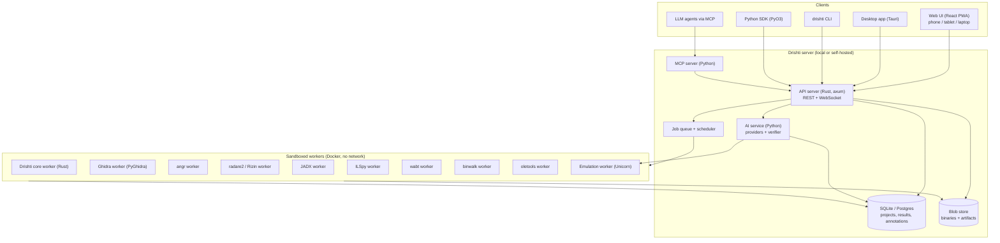
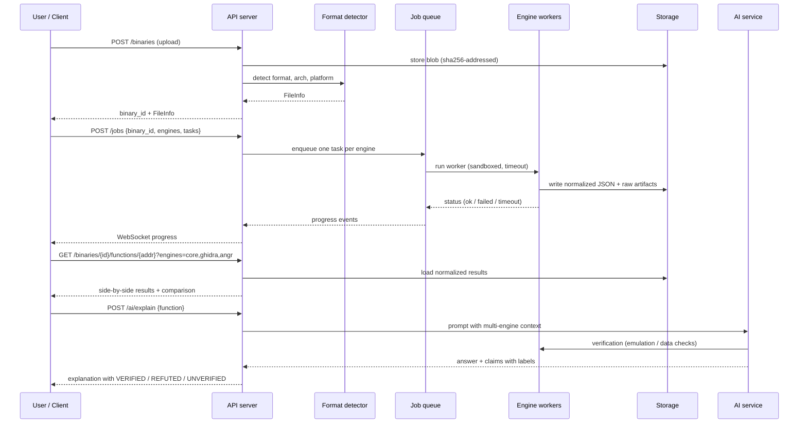
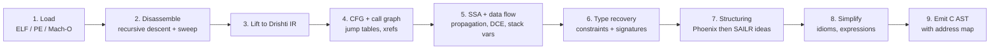
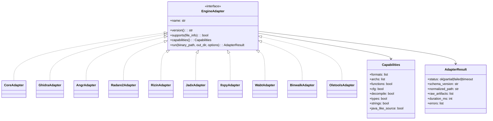

# Drishti — AI-Assisted Reverse Engineering Platform

> **Project specification for implementation by a coding agent (Claude Code).**
> Codename: **Drishti** (Sanskrit/Hindi: "vision, insight"). Rename freely; update `README.md`, crate names and package names together.
>
> Owner: Vikram · Spec version: 1.0 · Date: 2026-11-11

---

## Table of contents

0. [How to use this document](#0-how-to-use-this-document)
1. [Project overview](#1-project-overview)
2. [Glossary](#2-glossary)
3. [System architecture](#3-system-architecture)
4. [Tech stack](#4-tech-stack)
5. [Repository layout](#5-repository-layout)
6. [Core data model and schema](#6-core-data-model-and-schema)
7. [Component specifications](#7-component-specifications)
8. [Security and sandboxing](#8-security-and-sandboxing)
9. [Testing strategy](#9-testing-strategy)
10. [Roadmap: phases, tasks and acceptance criteria](#10-roadmap-phases-tasks-and-acceptance-criteria)
11. [Coding conventions](#11-coding-conventions)
12. [Rules for the coding agent](#12-rules-for-the-coding-agent)
13. [Legal and ethical use](#13-legal-and-ethical-use)
14. [References](#14-references)
15. [Appendix A: suggested CLAUDE.md](#appendix-a-suggested-claudemd)

---

## 0. How to use this document

- This file is the **single source of truth** for what Drishti is and how it is built.
- Work **one phase at a time** (Section 10). Do not start a phase until the previous phase's acceptance criteria pass.
- Before working on a component, read its subsection in Section 7 and the relevant parts of Sections 6, 8 and 9.
- When a decision is not covered here, choose the simplest option that fits the architecture, then record it in `docs/DECISIONS.md` (one short entry: date, decision, reason, alternatives).
- If this spec and the code disagree, update whichever is wrong **in the same change** and note it in `docs/DECISIONS.md`.
- External library APIs change. **Always verify an API against the installed version** (docs, `--help`, source) before writing code against it. Never rely on memory for library signatures.

---

## 1. Project overview

### 1.1 One-line description

Drishti opens a compiled program (Windows, Linux, macOS, Android, .NET, Java, WebAssembly, firmware), shows what is inside it in readable form, decompiles it using **its own engine plus Ghidra, angr and other engines side by side**, and uses AI to name, explain and summarise code — with every AI claim **verified against the actual bytes**.

### 1.2 Goals

1. **Unified hub.** One interface over many analysis engines (own Rust core, Ghidra, angr, radare2/Rizin, JADX, ILSpy, wabt, binwalk, oletools).
2. **Own core engine** (Rust) for loading, disassembly, CFG, an IR, data-flow analysis and a basic decompiler — the learning and portfolio centrepiece.
3. **Multi-engine comparison.** Show outputs from 2+ decompilers for the same function and highlight disagreements.
4. **Verified AI assistance.** LLM renaming, summaries and explanations; a verifier labels each claim VERIFIED / REFUTED / UNVERIFIED.
5. **Works everywhere.** Web UI usable on phones, tablets and laptops; desktop app (Tauri); local-only mode with no server; optional self-hosted server mode.
6. **Agent-ready.** An MCP server so LLM agents (Claude Code, Claude Desktop, others) can drive Drishti.
7. **Safe by default.** All untrusted-file processing runs in sandboxed workers.

### 1.3 Non-goals (for v1)

- Replacing Ghidra/IDA feature-for-feature.
- A full interactive debugger (stretch goal only, Phase 9).
- Running heavy engines (Ghidra, angr) on mobile devices.
- Bypassing DRM, licence checks, or decrypting App Store–encrypted iOS apps.
- Executing untrusted binaries natively on the host — ever.

### 1.4 Target users

- Students and learners studying reverse engineering and CTFs.
- SOC / malware analysts doing triage.
- Mobile app security testers (Android APK focus).
- Vulnerability researchers who want multi-engine views and scripting.

### 1.5 Success criteria for v1

- Opens ELF, PE, Mach-O, APK and .NET binaries and shows a correct triage report.
- Own core: function-start recall ≥ 95% and precision ≥ 95% on the unstripped test corpus at -O0, ≥ 85% at -O2 (measured against symbols).
- Ghidra and angr decompilation visible side by side for any function in a supported binary.
- AI summaries for functions, each with verifier labels.
- Web UI usable on a 390 px-wide phone screen and on desktop.
- MCP server exposes at least 10 tools and works with Claude Code.

---

## 2. Glossary

| Term | Meaning |
| --- | --- |
| Binary | Any input program file (executable, library, app package, firmware image). |
| Engine | A backend that analyses a binary: Drishti core, Ghidra, angr, radare2, Rizin, JADX, ILSpy, wabt, binwalk, oletools. |
| Adapter | Code that runs one engine and converts its output to the Drishti normalized schema. |
| Normalized schema | Drishti's engine-independent JSON format for analysis results (Section 6). |
| IR | Intermediate representation: Drishti's small set of generic operations that machine instructions are lifted to. |
| Lifting | Translating machine instructions into IR. |
| CFG | Control-flow graph: basic blocks plus the jumps between them. |
| Basic block | A straight-line run of instructions with one entry and one exit. |
| SSA | Static single assignment: each variable is assigned exactly once. |
| Structuring | Turning a CFG into `if` / `while` / `switch` constructs. |
| Xref | Cross-reference: a place where code or data refers to an address. |
| Job | One analysis request: a binary plus a set of engines and tasks. |
| Claim | One factual statement produced by the AI layer that the verifier can check. |
| Worker | A sandboxed process/container that runs one engine on one binary. |

---

## 3. System architecture

### 3.1 System context



### 3.2 Deployment modes

| Mode | Where engines run | Where UI runs | Use case |
| --- | --- | --- | --- |
| **Local desktop** | Same machine (Docker for workers; core may run in-process) | Tauri desktop app | Laptop, offline, privacy |
| **Self-hosted server** | A server / home machine / cloud VM | Browser on any device incl. phone | Analyse from a phone, share with a team |
| **Lite mobile** | Drishti core compiled for Android/iOS (no Ghidra/angr) | Tauri mobile app | Quick offline triage: headers, strings, disassembly |
| **Headless** | Same machine | None (CLI / Python / MCP) | Automation, CI, agents |

All modes share the same API contract. The UI never talks to engines directly.

### 3.3 Analysis job lifecycle



### 3.4 Drishti core pipeline (own engine)



### 3.5 Engine adapter model



### 3.6 Key architectural decisions

1. **Engines are separate processes**, not linked libraries. Each worker is a CLI: `worker --input <file> --out <dir> --options <json>`. It writes `normalized.json` (Section 6) and optional raw artifacts. This keeps Java (Ghidra), Python (angr) and Rust code isolated, sandboxable and crash-safe.
2. **One normalized schema**, versioned (`schema/drishti.schema.json`). The UI, AI layer, comparison engine and MCP server only read the normalized schema.
3. **Content-addressed storage.** Binaries are stored by SHA-256. Results are keyed by `(sha256, engine, engine_version, options_hash)` and cached.
4. **API-first.** Every UI feature is an API call first. The CLI, Python SDK and MCP server use the same API.
5. **AI is optional and pluggable.** Drishti must be fully usable with AI disabled.

---

## 4. Tech stack

### 4.1 Languages

| Area | Language | Why |
| --- | --- | --- |
| Core engine, API server, CLI | **Rust** (stable, 2021 edition or newer) | Speed, memory safety when parsing hostile files, compiles to desktop + mobile |
| Engine adapters, AI service, MCP server | **Python 3.12+** | Ghidra (PyGhidra), angr, r2pipe and LLM SDKs are Python-first |
| Web UI | **TypeScript** | Type-safe UI, shares schema types |
| Ghidra extensions (if ever needed) | Java / Python via PyGhidra | Ghidra's native extension languages |

### 4.2 Libraries and tools

Verify the current version of each before use. Pin versions in lockfiles.

**Rust (core, API, CLI)**

| Purpose | Crate | Notes |
| --- | --- | --- |
| Binary formats | `goblin` | ELF, PE, Mach-O parsing. LIEF (Rust bindings) is an alternative if modification is needed. |
| Disassembly (x86/x64) | `iced-x86` | Pure Rust, very accurate x86 decoder; preferred for x86 |
| Disassembly (multi-arch) | `capstone` (capstone-rs) | ARM, ARM64, MIPS, RISC-V, etc. |
| Disassembly + lifting (later) | `sleigh-sys` / `rsleigh` | Reuse Ghidra SLEIGH specs for many CPUs (Phase 8+) |
| Emulation | `unicorn-engine` | Lifter differential testing, AI claim verification |
| Graphs | `petgraph` | CFG, call graph, dominators |
| HTTP API | `axum` + `tokio` + `tower-http` | REST + WebSocket |
| Serialization | `serde`, `serde_json` | Normalized schema |
| Schema | `schemars` | Generate JSON Schema from Rust types |
| Database | `sqlx` (SQLite first, Postgres later) | Migrations in `migrations/` |
| CLI | `clap` | `drishti` command |
| Errors / logs | `thiserror`, `anyhow`, `tracing`, `tracing-subscriber` | |
| Python bindings | `pyo3` + `maturin` | `drishti` Python package |
| Hashing | `sha2`, `md-5`, `tlsh` (or `ssdeep` binding) | File identity + fuzzy hashes |
| Strings | own implementation | ASCII + UTF-16LE, min length configurable |
| Testing | `insta` (snapshots), `proptest`, `cargo-fuzz` | |

**Python (adapters, AI, MCP)**

| Purpose | Package / tool |
| --- | --- |
| Env + deps | `uv` |
| Ghidra | Ghidra (latest 12.x) + **PyGhidra** in headless mode (bundled with recent Ghidra; verify API) |
| angr | `angr` (includes CLE, PyVEX, claripy, decompiler with SAILR structurer) |
| radare2 / Rizin | `r2pipe`, `rzpipe` |
| Android | **JADX** CLI (Java) for DEX → Java/Kotlin-like source; `androguard` optional for manifest parsing |
| .NET | **ILSpy** command line (`ilspycmd`, .NET tool) |
| Java | JADX (also handles `.jar`/`.class`) or CFR |
| WebAssembly | **wabt** (`wasm-objdump`, `wasm-decompile`) |
| Firmware | **binwalk** (v3, Rust-based) for extraction |
| Office / documents | **oletools** (`olevba`, `oleid`), `pdfid`-style PDF triage |
| Pattern scanning | `yara-python` (or `yara-x`) |
| Data models | `pydantic` v2 (generated from the JSON Schema) |
| LLM providers | `anthropic` SDK; local models via **Ollama** or **llama.cpp** server (OpenAI-compatible API) |
| MCP | official MCP Python SDK (`mcp`) |
| Testing | `pytest`, `hypothesis` |

**Web UI**

| Purpose | Library |
| --- | --- |
| Framework | React + TypeScript + Vite |
| Data fetching | TanStack Query |
| State | Zustand |
| Styling | Tailwind CSS |
| Code views | Monaco Editor (assembly, pseudocode, Java/C# source) |
| Graphs | Cytoscape.js + `cytoscape-elk` layout (CFG, call graph) |
| Hex view | virtualized custom component (`@tanstack/react-virtual`) |
| Tables | TanStack Table (virtualized) |
| PWA | `vite-plugin-pwa` |
| Types | generated from `schema/drishti.schema.json` (`json-schema-to-typescript`) |
| Tests | Vitest + Testing Library; Playwright for E2E (incl. mobile viewport) |

**Packaging and infrastructure**

| Purpose | Tool |
| --- | --- |
| Desktop + mobile shell | **Tauri 2** |
| Containers | Docker + Docker Compose |
| Task runner | `just` (or `make`) |
| CI | GitHub Actions |
| Docs | Markdown in `docs/`; optional mdBook |

---

## 5. Repository layout

```text
drishti/
├── PROJECT_SPEC.md              # this file
├── CLAUDE.md                    # short agent guide (Appendix A)
├── README.md
├── justfile                     # common commands: build, test, lint, corpus, up
├── docker-compose.yml
├── .github/workflows/           # CI
├── docs/
│   ├── DECISIONS.md             # architecture decision log
│   ├── ARCHITECTURE.md          # living version of Section 3
│   ├── IR.md                    # Drishti IR reference
│   └── user-guide/
├── schema/
│   ├── drishti.schema.json      # normalized schema (generated from Rust types, committed)
│   └── examples/                # example normalized.json files
├── crates/                      # Rust workspace
│   ├── drishti-model/           # schema types (serde + schemars)
│   ├── drishti-loader/          # format detection + ELF/PE/Mach-O loading
│   ├── drishti-disasm/          # decoders, recursive descent, function discovery
│   ├── drishti-ir/              # IR definition + lifters (x86-64 first, then AArch64)
│   ├── drishti-analysis/        # CFG, dominators, SSA, data flow, types
│   ├── drishti-decompile/       # structuring, C AST, printer
│   ├── drishti-emu/             # Unicorn wrapper
│   ├── drishti-worker/          # core worker binary (writes normalized.json)
│   ├── drishti-server/          # axum API server, queue, scheduler, storage
│   ├── drishti-cli/             # `drishti` CLI
│   └── drishti-py/              # PyO3 bindings
├── python/
│   ├── pyproject.toml
│   ├── drishti_adapters/        # one module per engine + common base
│   │   ├── base.py
│   │   ├── ghidra/
│   │   ├── angr/
│   │   ├── radare2/
│   │   ├── rizin/
│   │   ├── jadx/
│   │   ├── ilspy/
│   │   ├── wabt/
│   │   ├── binwalk/
│   │   └── oletools/
│   ├── drishti_ai/              # providers, prompts, tasks, verifier
│   ├── drishti_mcp/             # MCP server
│   └── tests/
├── web/                         # React UI (also used by Tauri)
├── apps/
│   └── tauri/                   # Tauri 2 shell (desktop + mobile targets)
├── docker/
│   ├── core-worker.Dockerfile
│   ├── ghidra-worker.Dockerfile
│   ├── angr-worker.Dockerfile
│   ├── r2-worker.Dockerfile
│   ├── jadx-worker.Dockerfile
│   ├── ilspy-worker.Dockerfile
│   ├── tools-worker.Dockerfile  # wabt, binwalk, oletools, yara
│   └── seccomp.json
├── corpus/
│   ├── src/                     # small C test programs (committed)
│   ├── build.sh                 # compiles the matrix (Section 9.2)
│   └── README.md                # NO real malware is ever committed
└── migrations/                  # SQL migrations
```

---

## 6. Core data model and schema

### 6.1 Principles

- Rust types in `crates/drishti-model` are the **source of truth**. `schemars` generates `schema/drishti.schema.json`; TypeScript and Pydantic types are generated from it.
- Every result carries `schema_version` (semver). Breaking changes bump the major version and add a migration note in `docs/DECISIONS.md`.
- All addresses are **virtual addresses** as `u64`, serialized as hex strings (`"0x401000"`) to avoid JavaScript precision loss.
- Every object produced by an engine records `engine` and `engine_version`.

### 6.2 Types (reference definitions)

Written in TypeScript notation for readability; implement in Rust first.

```ts
type Addr = string; // hex string, e.g. "0x401000"

interface FileInfo {
  sha256: string; md5: string; size: number;
  file_name: string;
  format: Format;            // see 7.1
  container?: "zip" | "fat-macho" | "firmware" | null;
  arch: "x86" | "x86_64" | "arm" | "aarch64" | "mips" | "mips64" | "riscv64" | "ppc" | "dalvik" | "cil" | "jvm" | "wasm" | "unknown";
  bits: 16 | 32 | 64 | null;
  endian: "little" | "big" | null;
  platform: "windows" | "linux" | "macos" | "ios" | "android" | "dotnet" | "java" | "web" | "embedded" | "unknown";
  entry_point?: Addr;
  is_stripped?: boolean;
  is_packed_suspected?: boolean;   // entropy + section heuristics
  compiler_hints?: string[];       // e.g. "gcc", "msvc", "go", "rust"
  children?: ChildFile[];          // files inside archives/APKs/firmware
}

interface ChildFile { path: string; sha256: string; format: Format; size: number; }

interface Section {
  name: string; vaddr: Addr; vsize: number;
  file_offset: number; file_size: number;
  perms: string;          // "r-x", "rw-"
  entropy: number;        // 0..8
}

interface Symbol {
  name: string; demangled?: string; addr: Addr; size?: number;
  kind: "function" | "object" | "import" | "export" | "label" | "unknown";
  library?: string;       // for imports
  source: "symtab" | "dynsym" | "export_table" | "import_table" | "pdb" | "dwarf" | "engine" | "user" | "ai";
}

interface StringRef {
  addr: Addr; value: string; encoding: "ascii" | "utf16le" | "utf8";
  xrefs: Addr[];
}

interface Instruction {
  addr: Addr; size: number; bytes: string;   // hex
  mnemonic: string; operands: string;
  kind?: "call" | "jump" | "cjump" | "ret" | "other";
  targets?: Addr[];
}

interface BasicBlock {
  start: Addr; end: Addr;                    // end exclusive
  instructions: Addr[];
  successors: { target: Addr; kind: "fallthrough" | "jump" | "true" | "false" | "switch" | "indirect" }[];
}

interface Function {
  engine: EngineId; engine_version: string;
  entry: Addr; name: string;
  name_source: "symbol" | "engine" | "signature" | "user" | "ai";
  size?: number;
  blocks: BasicBlock[];
  calls: Addr[];                 // direct call targets
  called_by: Addr[];
  is_thunk?: boolean; is_library?: boolean;
  signature?: string;            // e.g. "int __cdecl f(char *a1, int a2)"
  decompiled?: Decompilation;
  metrics?: { block_count: number; edge_count: number; cyclomatic: number; goto_count?: number; loc?: number };
}

interface Decompilation {
  engine: EngineId; language: "c" | "java" | "csharp" | "wasm-pseudo";
  code: string;
  line_map?: { line: number; addrs: Addr[] }[];   // pseudocode line -> instruction addresses
  variables?: { name: string; type?: string; storage?: string }[];
  warnings?: string[];
}

interface Xref { from: Addr; to: Addr; kind: "call" | "jump" | "data_read" | "data_write" | "string" | "pointer"; }

interface AnalysisResult {
  schema_version: string;
  engine: EngineId; engine_version: string;
  options_hash: string;
  started_at: string; duration_ms: number;
  status: "ok" | "partial" | "failed" | "timeout";
  file: FileInfo;
  sections: Section[];
  symbols: Symbol[];
  imports: Symbol[]; exports: Symbol[];
  strings: StringRef[];
  functions: Function[];
  xrefs: Xref[];
  findings?: Finding[];          // YARA hits, suspicious APIs, macros, etc.
  errors: { code: string; message: string }[];
}

interface Finding {
  kind: "yara" | "suspicious_api" | "packer" | "macro" | "high_entropy" | "embedded_file" | "other";
  severity: "info" | "low" | "medium" | "high";
  title: string; detail: string; addrs?: Addr[];
  source: EngineId | "rule";
}

type EngineId = "core" | "ghidra" | "angr" | "radare2" | "rizin" | "jadx" | "ilspy" | "wabt" | "binwalk" | "oletools" | "yara";
```

### 6.3 User annotations (separate from engine results)

Engine results are immutable cache entries. User and AI edits live in a separate table and are overlaid at read time.

```ts
interface Annotation {
  id: string; binary_sha256: string; addr: Addr;
  kind: "rename_function" | "rename_variable" | "comment" | "type" | "bookmark" | "tag";
  value: string; scope?: string;          // e.g. function entry for variables
  author: "user" | "ai";
  ai_status?: "verified" | "refuted" | "unverified" | "accepted" | "rejected";
  created_at: string; updated_at: string;
}
```

### 6.4 Database tables (initial)

`projects`, `binaries` (sha256 PK, file_info JSON), `project_binaries`, `jobs`, `tasks` (one per engine per job), `results` (sha256, engine, engine_version, options_hash, path to normalized.json, status), `annotations`, `ai_runs` (prompt hash, provider, model, tokens, cost, output, claims JSON), `settings`.

---

## 7. Component specifications

### 7.1 File intake and format detection

**Purpose:** identify what a file is, then route it to the right engines.

**Detection order (magic bytes first, extension last):**

| Format | Signature / rule |
| --- | --- |
| ELF | `7F 45 4C 46` |
| PE (incl. .NET) | `MZ` at 0, `PE\0\0` at `e_lfanew`. .NET if CLR runtime header data directory (index 14) is non-zero → `format: "pe-dotnet"` |
| Mach-O | `FEEDFACE`, `FEEDFACF`, `CEFAEDFE`, `CFFAEDFE` |
| Fat Mach-O vs Java class | Both start `CAFEBABE`. Fat Mach-O: next u32 (big-endian) is a small arch count (< 30). Java class: next u16 pair is minor/major version (major ≥ 45) |
| DEX | `dex\n` + 3-digit version + `\0` |
| ZIP-based | `PK\x03\x04`, then inspect entries: APK (`AndroidManifest.xml` + `classes*.dex`), IPA (`Payload/*.app/`), JAR (`META-INF/MANIFEST.MF` or `*.class`), Office OOXML (`[Content_Types].xml`), plain ZIP otherwise |
| WebAssembly | `00 61 73 6D` |
| OLE (old Office) | `D0 CF 11 E0 A1 B1 1A E1` |
| PDF | `%PDF-` |
| Firmware / raw | none of the above + user hint or binwalk signature scan → `raw` / `firmware` |

**Requirements:**
- Compute SHA-256, MD5, TLSH/ssdeep, size, overall and per-section entropy.
- Recursively list children of containers (APK, IPA, JAR, ZIP, firmware) up to a configurable depth (default 3) and size limit (default 2 GB total). Each child becomes its own binary entry linked to the parent.
- Flag likely packing: very high entropy sections (> 7.2), few imports, known packer section names (e.g. `UPX0`).
- Never trust extensions.

**Routing table (default engines per format):**

| Format | Default engines | Optional engines |
| --- | --- | --- |
| ELF / PE / Mach-O (native) | core, ghidra | angr, radare2, rizin, yara |
| PE .NET | ilspy, core (headers only) | ghidra, yara |
| APK | jadx (DEX), ghidra on each native `lib/*/*.so` | radare2, yara |
| DEX | jadx | — |
| JAR / class | jadx | — |
| IPA (unencrypted only) | ghidra on main Mach-O | radare2 |
| WASM | wabt | ghidra (if a WASM loader is installed) |
| Firmware / raw | binwalk → re-detect children | ghidra with user-supplied arch + base address |
| OLE / OOXML / PDF | oletools / PDF triage, yara | — |

### 7.2 Drishti core — loader (`drishti-loader`)

- Parse ELF, PE (PE32/PE32+), Mach-O (thin + fat) with `goblin`.
- Produce: sections/segments with permissions, symbols (incl. dynamic), imports/exports, relocations, entry point, TLS callbacks (PE), init/fini arrays (ELF), exception tables (`.pdata` on x64 PE, `.eh_frame` on ELF) as function-start hints.
- Build a **memory map**: virtual address → bytes, honouring segment alignment and zero-fill (`.bss`).
- Demangle C++ (Itanium + MSVC) and Rust symbols.
- Must never panic on malformed input; return structured errors. Fuzzed from Phase 1.

### 7.3 Drishti core — disassembler and function discovery (`drishti-disasm`)

- Decoder trait with implementations: `IcedX86` (x86, x86-64) first, `Capstone` for AArch64 and others later.
- **Recursive descent** from seeds: entry point, exports, symbols, exception-table starts, init arrays, TLS callbacks.
- Follow direct jumps/calls; record indirect ones for later resolution.
- **Jump-table recovery** (x86-64 first): detect `cmp idx, N; ja default; jmp [base + idx*scale]` and position-independent variants (`movsxd` + `add`), bounded by the compare.
- **Gap scanning:** after recursion, linear-sweep unexplored executable gaps for function prologues (`push rbp; mov rbp, rsp`, `endbr64`, `sub rsp, imm`), validated by successful decoding until a return/jump.
- **Tail-call detection:** a jump to another known function start or outside the current function's bounds.
- Output: instructions, basic blocks, functions, call graph, xrefs.
- Metric targets: Section 1.5.

### 7.4 Drishti IR and lifter (`drishti-ir`)

Design a small, typed, P-code-like IR. Every value has a bit width.

**Storage locations ("varnodes"):** `Reg(name, width)`, `Mem(addr_expr, width)`, `Const(value, width)`, `Temp(id, width)`.

**Operations (initial set):**

| Group | Ops |
| --- | --- |
| Data movement | `COPY`, `LOAD`, `STORE` |
| Integer arithmetic | `ADD`, `SUB`, `MUL`, `UDIV`, `SDIV`, `UREM`, `SREM`, `NEG` |
| Bitwise | `AND`, `OR`, `XOR`, `NOT`, `SHL`, `LSHR`, `ASHR`, `POPCOUNT` |
| Width changes | `ZEXT`, `SEXT`, `TRUNC`, `CONCAT`, `EXTRACT(lo, hi)` |
| Comparison | `EQ`, `NE`, `ULT`, `ULE`, `SLT`, `SLE` |
| Flags helpers | `CARRY`, `SCARRY`, `SBORROW` |
| Control flow | `BRANCH`, `CBRANCH`, `BRANCHIND`, `CALL`, `CALLIND`, `RETURN` |
| Other | `INTRINSIC(name, args)` (for SIMD, crypto, system instructions), `UNDEF` |

**Lifter rules:**
- One machine instruction → a sequence of IR ops with instruction address attached to each op.
- Model x86 flags (`CF`, `ZF`, `SF`, `OF`, `PF`, `AF`) explicitly; dead-flag elimination happens in analysis, not in the lifter.
- Start with the x86-64 integer subset that covers ≥ 95% of instructions in the corpus at -O2; everything else lifts to `INTRINSIC` with a warning.
- **Differential testing (mandatory):** for each lifted instruction pattern, run the original bytes in Unicorn and the IR in a reference IR interpreter from the same random initial state; registers, flags and memory must match. Use `proptest` to generate states.

Document the IR fully in `docs/IR.md`.

### 7.5 Analysis passes (`drishti-analysis`)

1. CFG construction on IR; dominator and post-dominator trees (Cooper–Harvey–Kennedy); loop detection (natural loops, irreducible region marking).
2. SSA construction (Cytron et al.: dominance frontiers + phi placement + renaming).
3. Passes: constant propagation, copy propagation, dead-code elimination (including dead flags), expression folding.
4. Stack frame analysis: track stack pointer deltas; recover locals and arguments by offset.
5. Calling-convention detection: System V AMD64 and Microsoft x64 first; argument and return value recovery.
6. Xrefs: code→code, code→data, string references.
7. Type recovery v1: simple constraint propagation (pointer vs integer vs float, sizes, signedness from comparisons and extensions), library function signatures from a header database (libc, Win32 subset). v2 (stretch): subtype constraints in the style of TIE / Retypd / BinSub.
8. Library function identification (stretch): hash-based signatures for statically linked libc functions (FLIRT-like).

### 7.6 Decompiler (`drishti-decompile`)

- Input: SSA-form IR per function after analysis passes.
- **Structuring v1:** region-based structuring in the spirit of Phoenix (acyclic regions → if/else; cyclic → while/do-while; leftover edges → `goto`/`break`/`continue`).
- **Structuring v2:** add compiler-aware de-optimisations inspired by SAILR (undo jump threading / duplicated return blocks, switch lowering recovery).
- Out-of-SSA conversion with copy coalescing to reduce variables.
- C AST → pretty-printer. Every output line maps back to instruction addresses (`line_map`).
- Readability metrics recorded per function: lines of code, goto count, number of casts, variables.

### 7.7 Engine adapters (`python/drishti_adapters`)

**Common contract (`base.py`):**

```python
class EngineAdapter(Protocol):
    name: str
    def version(self) -> str: ...
    def supports(self, info: FileInfo) -> bool: ...
    def capabilities(self) -> Capabilities: ...
    def run(self, binary_path: Path, out_dir: Path, options: dict) -> AdapterResult: ...
```

Each adapter ships as a worker entry point: `python -m drishti_adapters.<engine> --input F --out DIR --options JSON`.

All adapters must:
- Write `normalized.json` validated against the JSON Schema before exiting.
- Keep raw engine output in `DIR/raw/` for debugging.
- Respect a timeout (default 600 s; configurable per engine).
- Return `partial` instead of failing when some functions fail.
- Record the engine version.

**Per-engine notes:**

| Adapter | How | Produces | Notes |
| --- | --- | --- | --- |
| **Ghidra** | PyGhidra headless: import binary into a temporary project, run auto-analysis, iterate functions via the Flat/Program API, decompile each with `DecompInterface` (per-function timeout, e.g. 30 s) | functions, blocks, xrefs, strings, signatures, C decompilation with line→address map from the Clang token markup | Heaviest worker (JVM, 2+ GB RAM). Reuse a warm JVM per worker container. Verify PyGhidra API against installed Ghidra version |
| **angr** | `angr.Project(path, auto_load_libs=False)`, `CFGFast`, then `Decompiler` per function with the default (SAILR) structurer | functions, CFG, decompilation | Slow on large binaries: default to decompiling only functions requested by the user, not all |
| **radare2** | `r2pipe`: `aaa`, then `aflj`, `agfj`, `izj`, `iij`, `iEj`, `axtj`; pseudocode via `pdc` or r2ghidra plugin if installed | functions, CFG, strings, imports/exports | Fast triage engine |
| **Rizin** | `rzpipe` with equivalent JSON commands; RzIL output (`aoi`) optional | same as radare2 | Choose r2 or Rizin by config; both supported |
| **JADX** | `jadx --output-dir out --export-gradle` (or plain source export) | Java/Kotlin-like source tree, classes, methods; manifest | Map classes/methods into `functions` with `language: "java"` |
| **ILSpy** | `ilspycmd -p -o out file.dll` | C# project | Map types/methods into `functions` with `language: "csharp"` |
| **wabt** | `wasm-objdump -x -d`, `wasm-decompile` | functions, imports/exports, pseudo-code | |
| **binwalk** | signature scan + extraction into `out/extracted/` | `children` + findings | Extracted files are re-submitted as child binaries |
| **oletools** | `olevba`, `oleid` | macros (as `Finding` + source text), indicators | |
| **YARA** | `yara-python` with rule packs in `rules/` | findings | Rules are user-configurable |

### 7.8 Multi-engine comparison

- Match functions across engines by entry address; unmatched functions are listed per engine ("only Ghidra found this").
- Per matched function compute: boundary agreement (same end/size), block count difference, call-target set Jaccard similarity, decompiled LOC and goto count per engine.
- **Disagreement score** 0–100 combining the above. Sort the function list by it on demand ("show me where engines disagree").
- UI: side-by-side pseudocode panes (2 or 3 engines), synchronized scrolling by address via `line_map`, diff highlighting.

### 7.9 Emulation service (`drishti-emu`)

- Wraps Unicorn. Inputs: binary memory map, start address, initial registers, stop conditions (address, instruction count, timeout).
- Hooks: memory read/write logging, call interception for imports (stub common libc/Win32 functions with simple models; unknown imports stop emulation with a clear status).
- Used by: lifter differential tests, AI verifier, user-requested "emulate this function with these arguments", string decryption helpers.
- Hard limits: max 10 million instructions, 256 MB mapped memory, 30 s wall time per request (configurable).
- Never executes the binary natively.

### 7.10 AI layer (`python/drishti_ai`)

**Providers (pluggable, configured in settings/env):**
- `AnthropicProvider` — model name from config (no hard-coded model strings; the user picks).
- `OpenAICompatibleProvider` — for local servers (Ollama, llama.cpp, vLLM).
- `NullProvider` — AI disabled.

**Tasks:**

| Task | Input context | Output |
| --- | --- | --- |
| `name_function` | pseudocode from all available engines, callees' names, referenced strings/imports | proposed name + one-line rationale + claims |
| `name_variables` | pseudocode + types | mapping old → new names |
| `summarize_function` | as above | 2–4 sentence summary + claims |
| `explain_selection` | selected lines + surrounding function | plain-language explanation |
| `suggest_types` | variable usage + offsets | struct/field proposals + claims about offsets/sizes |
| `triage_report` | FileInfo, imports, strings, findings, top functions | structured report: what the program does, notable capabilities, IOCs |

**Prompting rules:**
- Always include **multiple engines' output** when available, labelled by engine.
- Ask for structured JSON output (validated with Pydantic). Each output contains a `claims` list.
- Keep prompts in `drishti_ai/prompts/*.md` with version headers; log the prompt hash with every run.
- Context budget: summarise callees by name + one-line summary instead of full code.

**Claims and verifier:**

```json
{
  "claims": [
    {"type": "calls_import", "function": "0x401200", "import": "CreateFileW"},
    {"type": "references_string", "function": "0x401200", "value": "config.ini"},
    {"type": "returns_constant", "function": "0x401500", "value": 0},
    {"type": "field_offset", "struct": "Conn", "field": "port", "offset": 8, "size": 2},
    {"type": "loops_over", "function": "0x401200", "description": "..."}
  ]
}
```

| Claim type | How it is checked |
| --- | --- |
| `calls_import`, `calls_function` | Call graph + xrefs from engine results |
| `references_string` | String xrefs |
| `returns_constant` | Emulate the function from several random states; all returns equal the value |
| `field_offset` | Memory-access offsets observed in IR / decompilation for that pointer |
| Free-text claims | `unverified` (shown, but clearly marked) |

- Labels: **VERIFIED**, **REFUTED**, **UNVERIFIED**. Refuted suggestions are never auto-applied.
- AI suggestions become `Annotation` rows with `author: "ai"` and must be accepted by the user before they replace names in the default view (configurable "auto-accept verified").
- Cache AI results by `(prompt hash, input hash, model)`.
- Track tokens and cost per run; show totals in settings.

### 7.11 MCP server (`python/drishti_mcp`)

Exposes Drishti to LLM agents. Calls the API server; never touches engines directly.

**Tools (v1):**

| Tool | Description |
| --- | --- |
| `upload_binary(path)` | Upload a file, return `binary_id` + FileInfo |
| `start_analysis(binary_id, engines?)` | Start a job; return job id |
| `job_status(job_id)` | Progress per engine |
| `file_info(binary_id)` | Format, arch, hashes, sections, findings |
| `list_functions(binary_id, engine?, filter?, limit?)` | Function list with names, sizes, disagreement scores |
| `decompile(binary_id, addr, engines?)` | Pseudocode from one or more engines |
| `disassemble(binary_id, addr, count?)` | Instructions |
| `xrefs_to(binary_id, addr)` / `xrefs_from(...)` | Cross-references |
| `strings(binary_id, filter?)` | Strings with xrefs |
| `imports_exports(binary_id)` | Imports/exports |
| `compare_engines(binary_id, addr)` | Comparison metrics + diff |
| `rename(binary_id, addr, new_name)` | Create a user annotation |
| `comment(binary_id, addr, text)` | Add a comment |
| `emulate(binary_id, addr, args?, max_insns?)` | Bounded emulation result |
| `verify_claim(binary_id, claim)` | Run the verifier on a claim |

Transports: stdio (for Claude Code / Desktop) and HTTP/SSE.

### 7.12 API server (`drishti-server`)

REST under `/api/v1`, JSON, OpenAPI document generated (e.g. `utoipa`) and served at `/api/v1/openapi.json`.

| Method | Path | Purpose |
| --- | --- | --- |
| POST | `/binaries` | Upload (multipart; streaming; size limit configurable, default 500 MB) |
| GET | `/binaries/{sha}` | FileInfo + children |
| GET | `/binaries/{sha}/bytes?offset&len` | Raw bytes for the hex view (max 64 KB per call) |
| POST | `/jobs` | `{binary, engines[], options}` → job id |
| GET | `/jobs/{id}` | Status per task |
| WS | `/jobs/{id}/events` | Live progress |
| GET | `/binaries/{sha}/sections` · `/symbols` · `/imports` · `/exports` · `/strings` · `/findings` | Merged views (engine selectable via `?engine=`) |
| GET | `/binaries/{sha}/functions?engine&sort&filter&page` | Function list |
| GET | `/binaries/{sha}/functions/{addr}?engines=core,ghidra` | Function detail incl. blocks, decompilation per engine |
| GET | `/binaries/{sha}/functions/{addr}/compare?engines=` | Comparison metrics and diff |
| GET | `/binaries/{sha}/disasm?addr&count` | Disassembly window |
| GET | `/binaries/{sha}/xrefs?to=` · `?from=` | Xrefs |
| GET | `/binaries/{sha}/callgraph?root&depth` | Call graph subset |
| POST/GET/PATCH/DELETE | `/binaries/{sha}/annotations` | User/AI annotations |
| POST | `/ai/{task}` | Run an AI task (Section 7.10) |
| POST | `/emulate` | Bounded emulation |
| POST | `/verify` | Verify a claim |
| GET/POST | `/projects` · `/projects/{id}` | Group binaries |
| GET | `/engines` | Installed engines, versions, health |
| GET/PUT | `/settings` | AI provider, limits, engine defaults |
| GET | `/health` | Liveness |

**Auth:** local mode binds to `127.0.0.1` with no auth. Server mode requires auth (API tokens to start; OIDC later) and HTTPS behind a reverse proxy.

**Job queue v1:** in-process `tokio` scheduler with state persisted in SQLite; per-engine concurrency limits (e.g. Ghidra 1–2 at a time). v2: Redis-backed queue for multi-machine workers.

### 7.13 Storage

- Blobs: `data/blobs/<sha[0:2]>/<sha>`; artifacts: `data/results/<sha>/<engine>/<engine_version>/<options_hash>/`.
- SQLite for local and small deployments; Postgres optional via `sqlx` feature flag.
- Retention settings: delete raw artifacts after N days; keep normalized results.
- Export/import a project as a single `.drishti` archive (zip of DB rows as JSON + normalized results + annotations; binaries optional).

### 7.14 Web UI (`web/`)

**Layout:** responsive. Desktop: resizable panes. Tablet: two panes. Phone (≥ 360 px): single pane with bottom tab bar; every view must be usable with touch.

**Views and features:**

| View | Features |
| --- | --- |
| Home / Projects | Upload (drag-drop, file picker, phone share-sheet via PWA), recent binaries, projects |
| Triage dashboard | FileInfo, hashes, format/arch/platform, entropy chart per section, packer warning, imports grouped by capability (network, file, crypto, process, registry), findings, children tree |
| Functions list | Virtualized table: name, address, size, blocks, engines that found it, disagreement score; search; filters (named/unnamed, library, thunk) |
| Disassembly | Linear listing with addresses, bytes, mnemonics, comments, labels, xref hints; jump-to-address; click operand → follow |
| CFG graph | Cytoscape + ELK; blocks show instructions; true/false edges coloured; zoom/pan/pinch; minimap on desktop |
| Decompiler | Monaco, read-only; tabs or side-by-side per engine; click a line → highlight instructions in disassembly and blocks in CFG (via `line_map`); rename on click |
| Compare | 2–3 engines side by side, synchronized scroll, diff highlights, metrics header |
| Hex view | Virtualized; section colouring; selection ↔ disassembly sync; data interpretation panel (u8…u64, float, string) |
| Strings | Table with encoding, xrefs, filters, regex search |
| Imports / exports | Grouped by library |
| Xrefs panel | To/from current address |
| Call graph | Neighbourhood view with depth control |
| AI panel | Summary, suggested names, explanations; each claim with a VERIFIED/REFUTED/UNVERIFIED badge; accept/reject buttons; cost display |
| Emulator | Set registers/args, run a function with limits, see trace and memory writes |
| Android view | Package tree from JADX, manifest (permissions, components), native libs linked to their native analysis |
| .NET / Java view | Namespace/class tree with source |
| Settings | Engines (enable/disable, timeouts), AI provider + model + API key (stored server-side, never in browser storage), limits, theme |

**Navigation:** global "Go to" (`g` shortcut on desktop, search button on mobile) accepting address, function name or string; back/forward history.

**Theme:** light/dark; monospace font for code views.

**Accessibility:** keyboard navigation on desktop, sufficient contrast, labels on icon buttons.

### 7.15 Desktop and mobile packaging (`apps/tauri`)

- Tauri 2 shell loading the same `web/` build.
- **Desktop:** bundles the `drishti-server` as a sidecar bound to `127.0.0.1`; uses Docker for heavy workers if available, otherwise runs only the core engine in-process and shows which engines are unavailable.
- **Mobile (lite):** compiles `drishti-loader`, `drishti-disasm` and a minimal IR-free view into the app (no Docker, no Ghidra/angr). Can also connect to a remote Drishti server (URL + token) for full analysis.
- **PWA:** the web UI is installable on phones when served by a Drishti server.

### 7.16 CLI (`drishti-cli`)

```text
drishti info <file>                       # FileInfo as table or --json
drishti strings <file> [--min 4] [--json]
drishti disasm <file> [--addr 0x..] [--count N]
drishti functions <file> [--engine core|ghidra|angr] [--json]
drishti decompile <file> --addr 0x.. [--engines core,ghidra]
drishti compare <file> --addr 0x.. --engines ghidra,angr
drishti analyze <file> [--engines ...] [--wait]
drishti ai summarize <file> --addr 0x..
drishti serve [--host 127.0.0.1] [--port 7878]
drishti engines                            # list installed engines + health
```

`--json` on every command outputs the normalized schema (or a documented subset).

### 7.17 Plugin system

- **Engine plugins:** any executable implementing the worker contract (7.7) and registered in `engines.toml` (name, command, container image, supported formats, timeout).
- **Core analysis plugins (later):** Rust trait `AnalysisPass` registered in a pass manager; Python passes via the PyO3 API.
- **UI plugins (later):** extra panels loaded from a manifest.

---

## 8. Security and sandboxing

Drishti processes **untrusted, possibly malicious files**. Treat every input as hostile.

1. **Never execute input binaries natively.** Only parsing, static analysis and Unicorn emulation.
2. **Workers run in containers** with:
   - `--network none`
   - read-only root filesystem; input mounted read-only; output to a dedicated writable directory; `tmpfs` for `/tmp`
   - non-root user, all Linux capabilities dropped, `no-new-privileges`, custom seccomp profile (`docker/seccomp.json`)
   - CPU, memory and PID limits; wall-clock timeout enforced by the scheduler
3. **Parsers are fuzzed** (`cargo-fuzz` targets for loader, format detector, disassembler) from Phase 1; fuzzing runs in CI on a schedule.
4. **Archive safety:** guard against zip bombs (ratio + total size limits), path traversal on extraction (normalize and reject `..` and absolute paths), symlinks inside archives.
5. **Server mode:** auth required, rate limiting on uploads and AI endpoints, HTTPS, uploads stored outside the web root, content served with `Content-Disposition: attachment` and never rendered.
6. **Secrets:** AI API keys stored server-side (env or encrypted settings); never sent to the browser; never logged.
7. **AI data policy:** a visible setting chooses whether code may be sent to a cloud LLM; default for files tagged "sensitive" is local model only or AI off.
8. **Dependency hygiene:** keep Ghidra and other engines updated (Ghidra has shipped security fixes, e.g. path-traversal fixes in 12.1.x); `cargo audit`, `pip-audit`, `npm audit` in CI.
9. **Malware handling:** no real malware in the repository or CI. Malware testing only in an isolated lab VM by the user, with samples from legitimate research sources.

---

## 9. Testing strategy

### 9.1 Test levels

| Level | What | Tools |
| --- | --- | --- |
| Unit | Each crate/module | `cargo test`, `pytest`, Vitest |
| Snapshot | Loader output, disassembly, decompiled C for corpus functions | `insta` |
| Property | Lifter vs Unicorn differential tests; parser robustness | `proptest`, `hypothesis` |
| Fuzz | Loader, detector, disassembler, archive extraction | `cargo-fuzz` |
| Integration | Each adapter on corpus binaries → schema-valid `normalized.json` | pytest + Docker |
| API | All endpoints, auth, limits | Rust integration tests |
| E2E | Upload → analyse → view function → AI panel; desktop and 390 px mobile viewport | Playwright |
| Accuracy benchmarks | Function detection, decompiler quality | `bench/` scripts producing a Markdown report |

### 9.2 Test corpus (`corpus/`)

- `corpus/src/`: 30–50 small C programs covering: loops, nested ifs, switch (dense + sparse), recursion, structs and arrays, function pointers, varargs, string handling, bit manipulation, floating point, simple state machines, a tiny HTTP-style parser, a tiny XOR "string decryptor" (benign, for emulation tests).
- `corpus/build.sh` compiles a matrix:
  - compilers: `gcc`, `clang` (and MSVC/MinGW for PE when available)
  - optimisation: `-O0`, `-O1`, `-O2`, `-O3`, `-Os`
  - arch: x86-64 (first), AArch64 (cross-compiler, Phase 8)
  - variants: with debug info (`-g`, ground truth), stripped (`strip`)
- Also use real open-source binaries (e.g. GNU coreutils, busybox) built locally.
- Android: a small sample APK built from a template app (no third-party APKs committed).
- Built binaries are **not committed** (generated by CI and locally); a manifest with hashes is committed.

### 9.3 Ground truth and metrics

| Metric | Ground truth | Target (v1) |
| --- | --- | --- |
| Function-start precision / recall | Symbols + DWARF of the `-g` build | ≥ 95% / ≥ 95% at -O0; ≥ 85% / ≥ 85% at -O2 |
| Instruction decoding | `objdump` / iced reference on known code regions | 100% agreement on reached code |
| Lifter correctness | Unicorn differential tests | 0 mismatches on covered instruction set |
| Decompiler recompilability | Insert decompiled function into a harness, compile | Track %, improve per release |
| Decompiler behaviour | Run harness tests for corpus functions | Track pass rate vs Ghidra and angr |
| Structuredness | goto count vs source | Track; fewer than Ghidra on corpus at -O0 is a stretch goal |
| Adapter health | Schema validation | 100% of corpus runs produce valid JSON or a clear failure |

Benchmarks produce `bench/report.md` with a table per metric and per engine (core, Ghidra, angr) so progress is visible over time.

---

## 10. Roadmap: phases, tasks and acceptance criteria

Estimates assume part-time work. Each phase ends with a tagged release and a short write-up in `docs/devlog/`.

### Phase 0 — Foundations (1 week)

Tasks:
- [ ] Create repository layout (Section 5), Rust workspace, Python project with `uv`, web app scaffold, `justfile`.
- [ ] CI: build + lint + test for Rust, Python, web.
- [ ] `drishti-model` with initial types; generate `schema/drishti.schema.json`; generate TS and Pydantic types.
- [ ] `docs/DECISIONS.md`, `docs/ARCHITECTURE.md`, `CLAUDE.md` (Appendix A).

Acceptance:
- `just check` runs fmt, clippy (deny warnings), ruff, mypy/pyright, eslint, all tests — green in CI.
- Schema generation is reproducible (CI fails if the committed schema is stale).

### Phase 1 — Format detection + loader + triage CLI (2–3 weeks)

Tasks:
- [ ] Format detector (7.1) for all listed formats incl. ZIP inspection and `CAFEBABE` disambiguation.
- [ ] ELF/PE/Mach-O loader (7.2): sections, symbols, imports/exports, entry, memory map, entropy, packer heuristics, demangling.
- [ ] String extraction (ASCII + UTF-16LE).
- [ ] `drishti info`, `drishti strings` CLI with `--json`.
- [ ] Fuzz targets for detector and loader.
- [ ] Corpus build script (x86-64, gcc/clang, all opt levels).

Acceptance:
- Correct FileInfo for every corpus binary plus sample PE and Mach-O files.
- Detector correctly classifies a test set of ≥ 1 file per format (incl. APK, JAR, DEX, WASM, OLE, PDF, fat Mach-O, Java class).
- 1 hour of fuzzing per target with no crashes.

### Phase 2 — Disassembler, functions, CFG + minimal API and UI (4–6 weeks)

Tasks:
- [ ] x86-64 decoding with iced-x86; recursive descent; jump tables; gap scanning; tail calls (7.3).
- [ ] Basic blocks, CFG, call graph, xrefs; core worker writing `normalized.json`.
- [ ] API server v1: upload, jobs (core only), FileInfo, functions, disasm, xrefs, strings, bytes.
- [ ] Web UI v1: upload, triage dashboard, functions list, disassembly, CFG graph, hex view, strings — responsive down to 360 px.
- [ ] Benchmark script for function detection.

Acceptance:
- Function-detection targets for -O0 met; -O2 measured and reported.
- E2E test: upload a corpus binary from a 390 px viewport, open `main`, view CFG.

### Phase 3 — Ghidra + angr adapters and comparison (3–4 weeks)

Tasks:
- [ ] Adapter base + worker contract + Docker images with sandbox settings (Section 8).
- [ ] Ghidra adapter (PyGhidra headless) with decompilation and `line_map`.
- [ ] angr adapter with on-demand decompilation.
- [ ] Scheduler: per-engine concurrency, timeouts, caching by `(sha, engine, version, options)`.
- [ ] Comparison engine (7.8) + Compare view + disagreement-score sorting.
- [ ] Decompiler view with line → address sync.

Acceptance:
- For every corpus binary, Ghidra and angr results are schema-valid or fail with a clear error.
- Side-by-side Ghidra vs angr pseudocode for any function, synchronized by address.
- Workers verified to have no network access (integration test attempts a connection and must fail).

### Phase 4 — More formats: Android, .NET, Java, WASM, firmware, documents (3–4 weeks)

Tasks:
- [ ] JADX, ILSpy, wabt, binwalk, oletools, YARA adapters.
- [ ] Container children: APK native libs analysed as child binaries and linked in the UI.
- [ ] Android view (package tree, manifest permissions/components), .NET/Java class trees, findings view.
- [ ] Archive safety checks (Section 8.4) with tests (zip bomb, traversal).

Acceptance:
- Sample APK: Java sources browsable, permissions listed, native `.so` decompiled by Ghidra.
- Sample .NET DLL decompiled to C#; sample JAR decompiled; sample WASM shown; sample Office macro extracted as a finding.

### Phase 5 — Own IR, lifter and data flow (6–8 weeks)

Tasks:
- [ ] IR definition + `docs/IR.md` + IR interpreter.
- [ ] x86-64 lifter for the integer subset; `INTRINSIC` fallback.
- [ ] Unicorn differential tests with `proptest`.
- [ ] Dominators, loops, SSA, constant/copy propagation, DCE (incl. flags), stack frame analysis, calling conventions.
- [ ] IR view in the UI (toggle between assembly and IR).

Acceptance:
- Lifter covers ≥ 95% of instructions (by count) in corpus `-O2` binaries; 0 differential-test mismatches.
- SSA verifier passes on all corpus functions (every use dominated by its definition).

### Phase 6 — Own decompiler (8+ weeks)

Tasks:
- [ ] Type recovery v1, library signature database (libc, Win32 subset).
- [ ] Phoenix-style structuring; out-of-SSA; C AST; printer with `line_map`.
- [ ] Add `core` as a third engine in the Compare view.
- [ ] Recompilation + behaviour harness and benchmark report vs Ghidra/angr.
- [ ] Structuring v2 with SAILR-inspired de-optimisations.

Acceptance:
- Core decompiler produces output for ≥ 95% of corpus functions at -O0 without crashing.
- Benchmark report published with goto counts, recompilability and behaviour pass rates for core, Ghidra and angr.

### Phase 7 — AI layer, verifier and MCP server (4–6 weeks)

Tasks:
- [ ] Provider abstraction (Anthropic, OpenAI-compatible local, Null).
- [ ] Tasks (7.10) with prompts, Pydantic schemas, caching, cost tracking.
- [ ] Verifier for all structured claim types; emulation service (7.9).
- [ ] AI panel in the UI with badges and accept/reject.
- [ ] MCP server with all v1 tools; documented setup for Claude Code.
- [ ] Optional experiment: fine-tune a small local model for function/variable naming using corpus pairs (debug vs stripped builds) and compare against the cloud model.

Acceptance:
- AI disabled → every non-AI feature still works.
- For a set of 50 corpus functions, report: % names judged acceptable, % claims verified/refuted/unverified.
- Claude Code connected over MCP can upload a binary, list functions, decompile, compare engines and rename a function.

### Phase 8 — Packaging and multi-architecture (3–4 weeks)

Tasks:
- [ ] Tauri desktop app (macOS Apple Silicon, Windows, Linux) with sidecar server.
- [ ] Tauri mobile lite build (Android first) + "connect to server" mode; PWA install.
- [ ] AArch64 support in core (Capstone decoder; SLEIGH-based lifting evaluated and recorded in DECISIONS.md).
- [ ] Project export/import (`.drishti`).
- [ ] Server mode hardening: auth tokens, rate limits, HTTPS docs.

Acceptance:
- Desktop installers build in CI for all three OSes.
- Android lite app shows triage + disassembly offline and full results from a remote server.
- AArch64 corpus: function-detection metrics reported.

### Phase 9 — Stretch goals

- Debugger integration (GDB remote serial protocol; record/replay traces).
- Binary diffing between versions (BinDiff/Diaphora-style function matching) for patch analysis.
- Collaboration: multiple users on one project, live annotations.
- Type recovery v2 (TIE / Retypd / BinSub-style constraints).
- FLIRT-like signature generation for static libraries.
- Deobfuscation passes (control-flow flattening recovery, opaque predicate removal via SMT).

---

## 11. Coding conventions

**General**
- Small, focused commits with clear messages (`feat(loader): parse PE TLS callbacks`). Conventional Commits style.
- Every public function and module has a doc comment explaining *why*, not just *what*.
- No `TODO` without an issue reference or a line in `docs/DECISIONS.md`.

**Rust**
- `cargo fmt`; `cargo clippy -- -D warnings`.
- No `unwrap()`/`expect()` on data derived from input files; use `Result` with `thiserror` errors.
- `#![forbid(unsafe_code)]` in all crates except where FFI requires it (document each `unsafe` block).
- Bounds-check every offset and size read from a file; use checked arithmetic for address calculations.

**Python**
- `ruff` (lint + format), type hints everywhere, `mypy --strict` or `pyright` strict on `drishti_ai` and `drishti_mcp`.
- Pydantic models generated from the JSON Schema; no hand-written duplicates.

**TypeScript**
- `strict: true`; ESLint + Prettier; no `any` without a comment.
- Components small; data fetching only through TanStack Query hooks in `web/src/api/`.

**Schema changes**
- Change Rust types → regenerate schema → regenerate TS/Pydantic → update adapters → update `schema/examples/` → bump `schema_version` when needed.

---

## 12. Rules for the coding agent

1. **Follow the phases in order.** Finish acceptance criteria before moving on. Keep a checklist in `docs/PROGRESS.md` and update it at the end of each work session.
2. **Plan before coding** a non-trivial task: write a short plan (files to touch, tests to add) and then implement.
3. **Tests first or alongside.** No feature is done without tests; run `just check` before declaring a task complete.
4. **Verify library APIs** against installed versions (docs, source, `--help`). Do not guess signatures from memory.
5. **Dependencies:** prefer those listed in Section 4. Adding a new dependency requires a one-line justification in `docs/DECISIONS.md`.
6. **Security rules in Section 8 are mandatory.** Never run an input binary natively, never give workers network access, never log secrets.
7. **No real malware** in the repo, tests or CI. Use the benign corpus.
8. **Keep the normalized schema the only contract** between engines and everything else.
9. **Don't silently change scope.** If something in this spec seems wrong or too costly, stop, explain the trade-off, propose an alternative, and record the decision.
10. **Small PR-sized changes.** One component or feature per change; update docs in the same change.
11. **Performance budgets:** core analysis of a 5 MB binary should complete in under 30 s on a laptop; UI views must stay responsive with 50 000 functions (virtualize lists).
12. **When stuck** on a reverse-engineering question, compare against Ghidra's output for the same binary as an oracle and note differences.

---

## 13. Legal and ethical use

- Drishti is for **education, security research, malware analysis, interoperability and analysis of software you own or are permitted to analyse.**
- Reverse engineering may be restricted by licence agreements (EULAs), copyright and anti-circumvention laws, which vary by country. Users are responsible for complying with them.
- Drishti does not include features for removing licence checks, DRM, or decrypting protected app-store binaries.
- Include this notice in `README.md` and the app's About screen.
- Respect the licences of integrated engines: Ghidra (Apache 2.0), radare2/Rizin (LGPL-3.0), angr (BSD), JADX (Apache 2.0), ILSpy (MIT), wabt (Apache 2.0), binwalk (MIT), oletools (BSD), Capstone/Unicorn/Keystone (BSD/GPL variants — verify each), LIEF (Apache 2.0). Verify each licence before bundling and list them in `THIRD_PARTY_LICENSES.md`.
- IDA Pro and Binary Ninja are commercial: Drishti may offer optional adapters that use a user's own licence but never bundles them.

---

## 14. References

**Surveys and decompilation research**
- Abusabha & Hwang, *The Evolution of Binary Decompilation in the Modern Era* (arXiv 2608.24955, 2026) — taxonomy of decompilation stages and tasks; paper list at github.com/lion10/csur2026_binary_decompilation
- Basque et al., *Ahoy SAILR! There is No Need to DREAM of C* (USENIX Security 2024) — compiler-aware structuring
- Yakdan et al., *No More Gotos* (DREAM, NDSS 2015)
- Schwartz et al., *Native x86 Decompilation Using Semantics-Preserving Structural Analysis and Iterative Control-Flow Structuring* (Phoenix, USENIX Security 2013)
- Gussoni et al., *A Comb for Decompiled C Code* (rev.ng Combing)

**Disassembly and function detection**
- Schwarz, Debray, Andrews, *Disassembly of Executable Code Revisited* (linear sweep vs recursive traversal)
- Flores-Montoya & Schulte, *Datalog Disassembly* (Ddisasm, USENIX Security 2020)
- Yu et al., *DeepDi* (USENIX Security 2022)
- Binary Ninja blog, *Architecture Agnostic Function Detection in Binaries* (2017)

**Type recovery**
- Lee, Avgerinos, Brumley, *TIE* (NDSS 2011)
- Noonan et al., *Polymorphic Type Inference for Machine Code* (Retypd, PLDI 2016)
- Smith (Trail of Bits), *BinSub* (2024)

**Frameworks and IRs**
- Ghidra decompiler and SLEIGH documentation; NCC Group, *Exploring Ghidra's decompiler internals* (2022)
- Hex-Rays microcode: Elastic Security Labs, *Introduction to Hex-Rays decompilation internals*
- Binary Ninja BNIL documentation (LLIL, MLIL, HLIL)
- Rizin RzIL release notes; radare2 ESIL
- Shoshitaishvili et al., *(State of) The Art of War* (angr, IEEE S&P 2016)
- Cytron et al., *Efficiently Computing Static Single Assignment Form* (TOPLAS 1991)
- Cooper, Harvey, Kennedy, *A Simple, Fast Dominance Algorithm* (2001)

**Neural / LLM decompilation**
- Tan et al., *LLM4Decompile* (EMNLP 2024) and *Decompile-Bench* (2025)
- DeGPT, DecLLM, SLaDe, ReF Decompile (see survey above)

**AI tooling**
- Model Context Protocol specification and Python SDK
- GhidraMCP (LaurieWired) and other RE MCP servers — for comparison of tool design

---

## Appendix A: suggested CLAUDE.md

Place this short file in the repository root so it loads every session; it points to this spec.

```markdown
# Drishti — agent guide

Full spec: PROJECT_SPEC.md (read the relevant section before each task).
Progress: docs/PROGRESS.md · Decisions: docs/DECISIONS.md

## Commands
- `just check`   fmt + lint + all tests (must be green before finishing a task)
- `just corpus`  build test binaries
- `just up`      start server + workers via Docker Compose
- `just schema`  regenerate JSON Schema, TS and Pydantic types

## Non-negotiables
- Work phase by phase (spec §10); update docs/PROGRESS.md at the end of each session.
- Never execute input binaries natively; workers have no network (spec §8).
- No real malware in the repo. No unwrap() on file-derived data in Rust.
- The normalized schema (schema/drishti.schema.json) is the only contract between engines and the rest.
- Verify third-party APIs against installed versions before using them.
- New dependency or scope change → one line in docs/DECISIONS.md.
```
